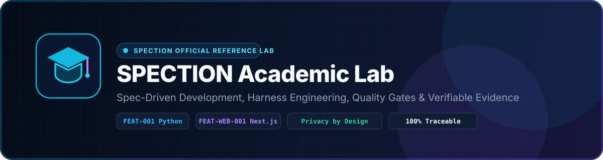
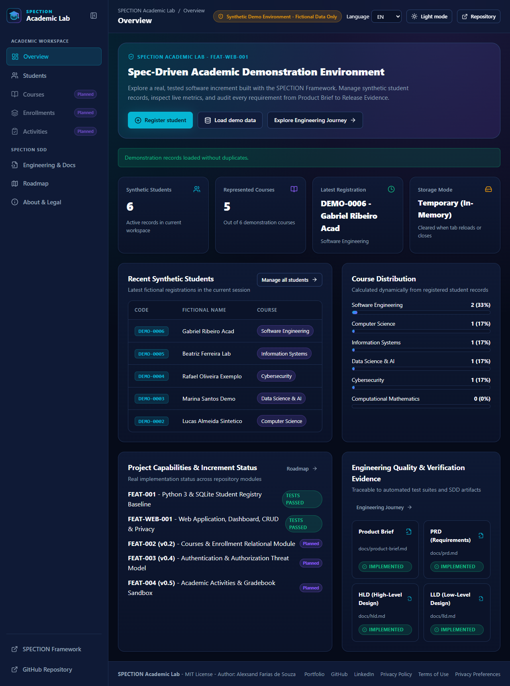
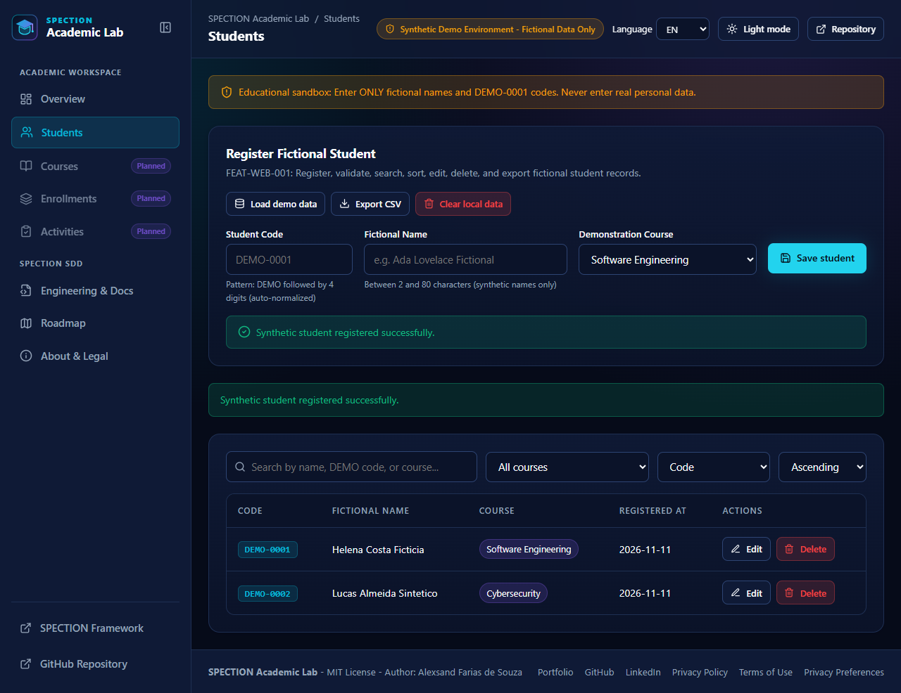
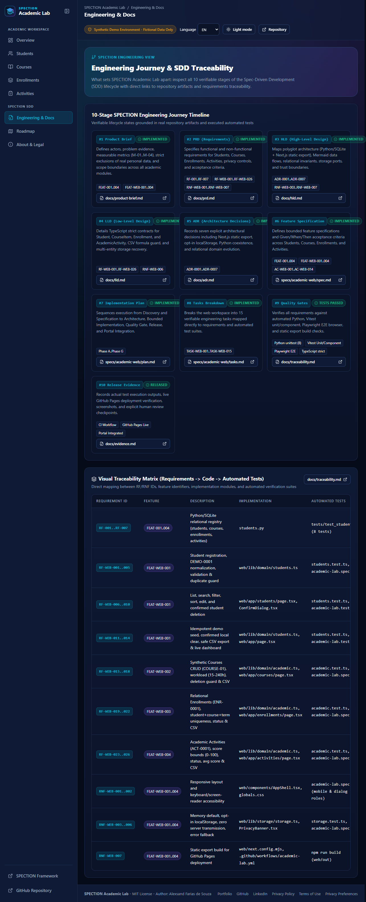
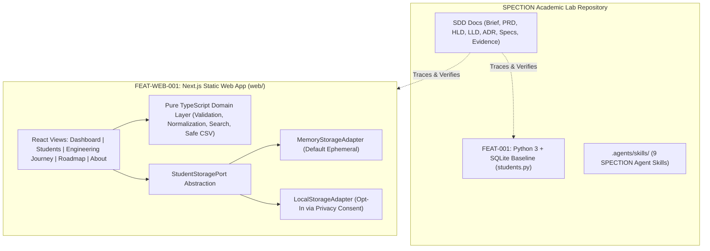

<p align="center">
  
</p>

<h1 align="center">SPECTION Academic Lab</h1>

<p align="center">
  <strong>Official Demonstration Project of the <a href="https://github.com/alexsandsouza/spection">SPECTION Framework</a></strong><br/>
  Spec-Driven Development (SDD) - Harness Engineering - Agent Skills - Quality Gates - Verifiable Evidence
</p>

<p align="center">
  <a href="https://github.com/alexsandsouza/spection-academic-lab/actions/workflows/academic-lab.yml"></a>
  <a href="LICENSE"></a>
  <a href="https://alexsandsouza.github.io/spection-academic-lab/"></a>
  <a href="https://alexsandsouza.github.io/spection/"></a>
</p>

<p align="center">
  <a href="https://alexsandsouza.github.io/spection-academic-lab/"><strong>Live Web Application</strong></a> |
  <a href="https://alexsandsouza.github.io/spection/"><strong>SPECTION Official Portal</strong></a> |
  <a href="https://github.com/alexsandsouza/spection"><strong>SPECTION Framework Repo</strong></a> |
  <a href="docs/evidence.md"><strong>Verification Evidence</strong></a> |
  <a href="#versao-em-portugues-br"><strong>Portugues (PT-BR)</strong></a>
</p>

---

## Navigation

1. [Overview & Purpose](#1-overview--purpose)
2. [Real Application Screenshots](#2-real-application-screenshots)
3. [Quick Start (Web & Python)](#3-quick-start-web--python)
4. [System Architecture (Mermaid)](#4-system-architecture-mermaid)
5. [SPECTION Engineering Journey & SDD Artifacts](#5-spection-engineering-journey--sdd-artifacts)
6. [Implemented vs. Planned Capabilities](#6-implemented-vs-planned-capabilities)
7. [Automated Testing & Verification Evidence](#7-automated-testing--verification-evidence)
8. [Privacy by Design (LGPD / GDPR Principles)](#8-privacy-by-design-lgpd--gdpr-principles)
9. [Contributing & Governance](#9-contributing--governance)
10. [License & Author](#10-license--author)
11. [Versao em Portugues (PT-BR)](#versao-em-portugues-br)

---

## 1. Overview & Purpose

**SPECTION Academic Lab** is an open-source, educational software engineering project created by **Alexsand Farias de Souza** to demonstrate how to build software step-by-step using **Spec-Driven Development (SDD)**, **Harness Engineering**, **Agent Skills**, automated quality gates, and verifiable release evidence.

This repository preserves two complementary implementations of the same synthetic student registry domain:

- **Historical Baseline (`FEAT-001`)**: A zero-dependency Python 3 and SQLite implementation (`students.py` and `tests/test_students.py`) demonstrating core domain rules and parameterized SQL safety.
- **Interactive Web Application (`FEAT-WEB-001`)**: A client-side web application (`web/`) built with **Next.js (App Router, Static Export)**, **React**, and **TypeScript (`strict` mode)**, hosted on GitHub Pages.

> **Synthetic Data Policy**: Use exclusively fictional student names and `DEMO-0001` identifiers. This project has no institutional affiliation, no backend database, and never collects or transmits real personal data.

---

## 2. Real Application Screenshots

Captured directly from automated Playwright browser execution (`npm run test:e2e`):

### Academic Dashboard (`Dark Theme`)


### Synthetic Student Registry (`FEAT-WEB-001` CRUD, Search, Filter & Export)


### SPECTION Engineering Journey & Live Traceability Matrix


---

## 3. Quick Start (Web & Python)

### 3.1 Run the Python Baseline (`FEAT-001`)

Requires Python 3.10+ (no external packages needed):

```sh
python students.py
python -m unittest discover -s tests -v
```

### 3.2 Run the Web Application (`FEAT-WEB-001`)

Requires Node.js 20+:

```sh
cd web
npm ci
npm run dev
```

Run the full quality gate locally:

```sh
cd web
npm run typecheck
npm test
npm run test:e2e
npm run build
```

---

## 4. System Architecture (Mermaid)



---

## 5. SPECTION Engineering Journey & SDD Artifacts

Every line of code in this repository is backed by reviewable engineering documentation:

| Stage | Artifact | Description | Status |
|---|---|---|---|
| **1. Product Brief** | [docs/product-brief.md](docs/product-brief.md) | Problem evidence, actors, goals, exclusions, metrics `M-01..M-04` | Implemented |
| **2. Requirements (PRD)** | [docs/prd.md](docs/prd.md) | `RF-001..RF-004`, `RF-WEB-001..RF-WEB-014`, `RNF-WEB-001..RNF-WEB-007` | Implemented |
| **3. High-Level Design** | [docs/hld.md](docs/hld.md) | Component architecture, storage ports, trust boundaries | Implemented |
| **4. Low-Level Design** | [docs/lld.md](docs/lld.md) | Strict TypeScript contracts, validation keys, CSV sanitization | Implemented |
| **5. ADRs** | [docs/adr.md](docs/adr.md) | [ADR-0001](docs/adr/0001-python-and-sqlite.md) through [ADR-0006](docs/adr/0006-github-pages-publishing.md) | Implemented |
| **6. Feature Specs** | [specs/feature-001.md](specs/feature-001.md), [specs/academic-web/spec.md](specs/academic-web/spec.md) | Bounded feature definitions and data models | Implemented |
| **7. Implementation Plan** | [specs/academic-web/plan.md](specs/academic-web/plan.md) | Phased execution plan (`Phase A` to `Phase G`) | Implemented |
| **8. Tasks Breakdown** | [specs/academic-web/tasks.md](specs/academic-web/tasks.md) | `TASK-WEB-001` through `TASK-WEB-012` | Implemented |
| **9. Acceptance & Traceability** | [specs/academic-web/acceptance.md](specs/academic-web/acceptance.md), [docs/traceability.md](docs/traceability.md) | Given/When/Then scenarios and requirement-to-test matrix | Tests Passed |
| **10. Release Evidence** | [docs/evidence.md](docs/evidence.md) | Real command outputs, test counts, and human review checkpoints | Tests Passed |

---

## 6. Implemented vs. Planned Capabilities

| Capability / Module | Feature ID | Status |
|---|---|---|
| Synthetic Student Registry CLI/SQLite (`DEMO-0001`, `COURSE-01`, `ENR`, `ACT`) | `FEAT-001..004` | Implemented & Tested |
| Academic Dashboard with Live Calculated Indicators & Chart | `FEAT-WEB-001` | Implemented & Tested |
| Web Student CRUD, Normalization, Validation & Duplicate Prevention | `FEAT-WEB-001` | Implemented & Tested |
| Synthetic Courses Catalog (`COURSE-01`), Workload & Referential Deletion Guard | `FEAT-WEB-002` | Implemented & Tested |
| Relational Student Enrollments (`ENR-0001`) per Academic Term | `FEAT-WEB-003` | Implemented & Tested |
| Academic Activities & Assessments (`ACT-0001`) with Live Gradebook Average | `FEAT-WEB-004` | Implemented & Tested |
| Safe CSV Export across all modules (Formula Injection Guard) | `FEAT-WEB-001..004` | Implemented & Tested |
| Privacy Banner, Memory Default, Opt-In `localStorage` & Revocation | `FEAT-WEB-001..004` | Implemented & Tested |
| SPECTION Engineering Journey & Visual Traceability Explorer | `FEAT-WEB-001..004` | Implemented & Tested |
| Bilingual UI (`EN` / `PT-BR`) & Theme Switching (`Dark` / `Light`) | `FEAT-WEB-001..004` | Implemented & Tested |
| Attendance, weighted grades & synthetic transcript (`v0.6`) | `FEAT-005` | Planned |
| Consolidated reports, PDF & validated JSON/CSV imports (`v0.7`) | `FEAT-006` | Planned |\n| Simulated RBAC personas & STRIDE model (`v0.8`) | `FEAT-007` | Planned |\n| Optional API/PostgreSQL architecture (`v0.9`) | `FEAT-008` | Planned |\n| Verified release and accessibility (`v1.0`) | `FEAT-009` | Planned |\n| Optional human-reviewed AI activity assistant (`v1.1`) | `FEAT-010` | Exploratory |

---

**[View the complete versioned roadmap and SDD acceptance criteria](docs/roadmap.md).** Planned releases are not available in the live demo until verification.\n\n---\n\n## 7. Automated Testing & Verification Evidence

All tests are executed in CI (`.github/workflows/academic-lab.yml`) and documented in [docs/evidence.md](docs/evidence.md):

- **Python Unit Tests (`unittest`)**: 8/8 passing (`tests/test_students.py`).
- **Domain & Storage Unit Tests (`Vitest`)**: 16/16 passing (`web/tests/unit/students.test.ts`, `web/tests/unit/academic.test.ts`, `web/tests/unit/storage.test.ts`).
- **Component Tests (`React Testing Library`)**: 5/5 passing (`web/tests/components/academic-lab.test.tsx`).
- **Browser End-to-End Tests (`Playwright`)**: 5/5 full user journeys passing (`web/tests/e2e/academic-lab.spec.ts`), including relational flows and mobile viewport navigation (`docs/screenshots/mobile-view.png`).

---

## 8. Privacy by Design (LGPD / GDPR Principles)

- **Ephemeral In-Memory Default (`RNF-WEB-003`)**: On first visit or when choosing *Essential Only*, student records are kept exclusively in browser tab memory and vanish upon reload.
- **Consent-Gated Local Storage (`RNF-WEB-004`)**: Browser `localStorage` is only used if the visitor explicitly clicks *Allow Local Storage*. Consent can be revoked at any time, immediately purging stored records.
- **Zero External Data Transmission (`RNF-WEB-005`)**: No backend servers, no advertising scripts, no analytics trackers, and zero data sent to AI models.
- **Legal Disclaimer**: This educational sandbox does not claim formal legal certification under LGPD or GDPR. Any institutional use with real personal data requires independent legal and security review.

---

## 9. Contributing & Governance

Contributions must follow [AGENTS.md](AGENTS.md) and the local SPECTION skills in `.agents/skills/`:
1. Review the Product Brief and PRD before editing code.
2. Map changes to explicit requirement IDs (`RF-###` / `RNF-###`).
3. Run the complete test suite and record real outputs in `docs/evidence.md`.
4. Never introduce real student data, secrets, or unverified claims.

---

## 10. License & Author

- **License**: Distributed under the [MIT License](LICENSE).
- **Author & Maintainer**: **Alexsand Farias de Souza**
  - SPECTION Portal: [https://alexsandsouza.github.io/spection/](https://alexsandsouza.github.io/spection/)
  - Portfolio: [https://alexsandsouza.github.io/](https://alexsandsouza.github.io/)
  - GitHub: [https://github.com/alexsandsouza](https://github.com/alexsandsouza)
  - LinkedIn: [https://www.linkedin.com/in/alexsandfarias](https://www.linkedin.com/in/alexsandfarias)

---

<h2 id="versao-em-portugues-br">11. Versao em Portugues (PT-BR)</h2>

### Sobre o SPECTION Academic Lab

O **SPECTION Academic Lab** e o projeto demonstrativo oficial do **[SPECTION Framework](https://github.com/alexsandsouza/spection)**, criado por **Alexsand Farias de Souza** para demonstrar, na pratica, como aplicar **Spec-Driven Development (SDD)**, **Harness Engineering**, **Agent Skills**, testes automatizados e evidencias verificaveis no desenvolvimento de software.

### Funcionalidades Entregues (`FEAT-001` + `FEAT-WEB-001`)

- **Dashboard Academico Real**: Indicadores calculados em tempo real (total de estudantes ficticios, cursos representados, ultimo cadastro, modo de armazenamento e grafico de distribuicao por curso).
- **Gestao de Estudantes Ficticios**: Cadastro com normalizacao automatica (`DEMO-0001`), validacao de nome (2 a 80 caracteres) e curso demonstrativo, prevencao de duplicidade, pesquisa instantanea, filtros, ordenacao, edicao, exclusao com confirmacao, carga demonstrativa sem duplicar e exportacao CSV protegida contra *CSV Injection*.
- **Privacidade desde a Concecao (Principios LGPD / GDPR)**: Armazenamento em memoria temporaria por padrao; persistencia opcional em `localStorage` mediante escolha explicita; revogacao imediata com exclusao dos dados locais; zero envio de dados para servidores ou IA.
- **SPECTION Engineering Journey**: Linha do tempo interativa das 10 etapas do ciclo SDD com estados verificaveis e matriz visual de rastreabilidade.
- **Preservacao Historica**: O modulo original em Python 3 e SQLite (`students.py` e `tests/test_students.py`) permanece preservado e validado no pipeline de CI/CD.

### Como Executar Localmente

```sh
# Executar baseline Python (FEAT-001)
python students.py
python -m unittest discover -s tests -v

# Executar aplicacao Web (FEAT-WEB-001)
cd web
npm ci
npm run typecheck
npm test
npm run test:e2e
npm run build
```
