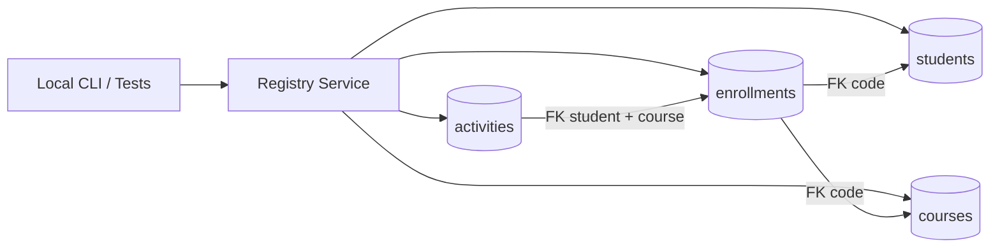
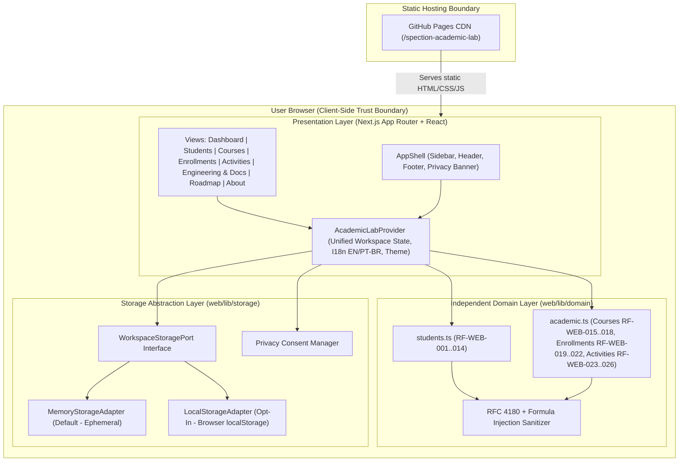

# High-Level Design (HLD) - SPECTION Academic Lab

## Document Control

- **Project**: SPECTION Academic Lab (`v0.5.0`)
- **Maintainer**: Alexsand Farias de Souza
- **Related Documents**: [PRD](prd.md), [LLD](lld.md), [ADR Index](adr.md)

---

## 1. System Context & Polyglot Architecture Overview

SPECTION Academic Lab provides two synchronized implementations of the synthetic academic domain (`Students`, `Courses`, `Enrollments`, and `Activities`):

1. **Python/SQLite Reference Implementation (`FEAT-001`..`FEAT-004`)**: Zero-dependency Python 3 module (`students.py`) backed by SQLite (`:memory:` by default) enforcing relational integrity across `students`, `courses`, `enrollments`, and `activities` tables.
2. **Next.js Static Web Application (`FEAT-WEB-001`..`FEAT-WEB-004`)**: Client-side web application (`web/`) built with React and TypeScript (`strict` mode) providing interactive management for all four academic modules, real-time analytics, and privacy-by-design storage adapters.

---

## 2. Python Relational Architecture (`FEAT-001`..`FEAT-004`)

---

## 3. Web Application Architecture (`FEAT-WEB-001`..`FEAT-WEB-004`)

---

## 4. Relational Domain Invariants

1. **Course Deletion Guard (`RF-WEB-017`)**: A course (`COURSE-01`) cannot be deleted while one or more enrollments reference its `id` or `code`.
2. **Student Deletion Cascade (`RF-WEB-010`)**: When a student is deleted after explicit confirmation, any enrollments and activities belonging to that student are cleanly removed to prevent orphan records.
3. **Enrollment Uniqueness (`RF-WEB-021`)**: A student cannot be enrolled twice in the same course during the same academic term (`2026.1`, `2026.2`, `2027.1`).
4. **Activity Referential & Score Bounds (`RF-WEB-024`, `RF-WEB-025`)**: Every activity (`ACT-0001`) must reference an active/existing enrollment and carry a numeric score between `0` and `100` inclusive.

---

## 5. Trust Boundaries & Security Controls

| Boundary | Description | Controls Applied |
|---|---|---|
| **User Input -> Domain Layer** | Untrusted text/numbers entered in forms or filters. | Trimming, uppercase code normalization (`DEMO-0001`, `COURSE-01`, `ENR-0001`, `ACT-0001`), strict regex patterns, numeric bounds (`15..240` hours, `0..100` scores), React automatic HTML escaping. |
| **Domain Layer -> Browser `localStorage`** | Persistence boundary on the local device. | Blocked unless `consent.allowLocalStorage === true`. Schema validation per entity on load; `try/catch` fallback to memory (`RNF-WEB-006`). |
| **Domain Layer -> CSV File Export** | Data exported from Students, Courses, Enrollments, or Activities. | RFC 4180 quote escaping plus formula-prefix neutralization (`'`, `=`, `+`, `-`, `@`, `\t`, `\r`) (`RF-WEB-013`). |
| **Browser -> Network** | Static asset delivery from GitHub Pages. | Zero application API calls (`RNF-WEB-005`). No third-party tracking or analytics. |

## FEAT-005 - Academic Intelligence architecture extension

The existing AcademicLabContext continues to own the v0.5 students, courses, enrollments, and activities. A nested AcademicProgressProvider stores attendance sessions, records and grade weights. It derives transcript rows from the canonical existing enrollment/activity records rather than copying grade values.

Flow: ProgressPage -> AcademicProgressContext -> pure progress domain -> optional privacy-gated browser storage. The existing AppShell and GitHub Pages static export remain unchanged.

Trust boundary: progress uses only fictional records and never sends them to an API. New key spection_academic_lab_progress_v1 is written only after opt-in; both consent refusal and revocation purge it. A distinct validated snapshot is used to avoid changing legacy collection schemas.
