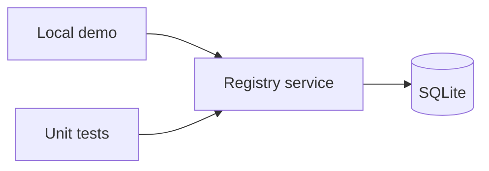

# HLD

Local Python process, registry service and SQLite persistence boundary. No network, web API or institution integration. Default database is in memory; optional explicit database path. Future web interface requires separate threat model and authorization design.
