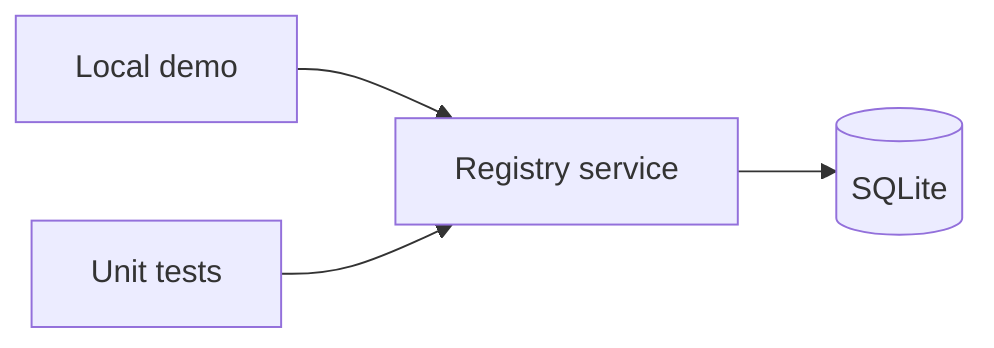
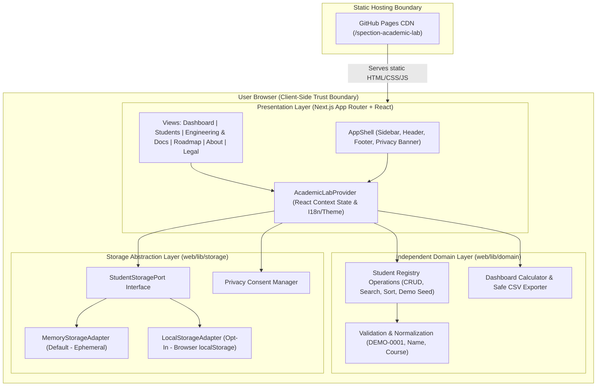

# High-Level Design (HLD) - SPECTION Academic Lab

## Document Control

- **Project**: SPECTION Academic Lab
- **Maintainer**: Alexsand Farias de Souza
- **Related Documents**: [PRD](prd.md), [LLD](lld.md), [ADR Index](adr.md)

---

## 1. System Context & Dual Implementation Overview

SPECTION Academic Lab provides two complementary implementations of the same synthetic student registry domain:

1. **Historical Reference Implementation (`FEAT-001`)**: A zero-dependency Python 3 module (`students.py`) backed by SQLite (`:memory:` by default), demonstrating backend/CLI domain modeling and unit testing.
2. **Web Demonstration Application (`FEAT-WEB-001`)**: A client-side Next.js static web application (`web/`) built with React and TypeScript (`strict` mode), demonstrating interactive UI, design system tokens, privacy-by-design storage adapters, and multi-layered automated testing.

---

## 2. Historical Python Architecture (FEAT-001)

Local Python process, registry service, and SQLite persistence boundary. No network, web API, or institution integration. Default database is in memory; optional explicit database path.

---

## 3. Web Application Architecture (FEAT-WEB-001)

### 3.1 Component & Layer Diagram

### 3.2 Data Flow

1. **Initial Load**:
   - Static HTML, CSS, and JS bundles are loaded from GitHub Pages.
   - `PrivacyConsentManager` checks whether the user has previously made an explicit privacy choice.
   - If no choice exists (or if the user selected **Essential Only**), the application initializes `MemoryStorageAdapter` (`RNF-WEB-003`).
   - If the user explicitly authorized local storage (`allowLocalStorage: true`), the application initializes `LocalStorageAdapter` and validates any stored records (`RNF-WEB-004`, `RNF-WEB-006`).
2. **Student Mutation (Create / Edit / Delete / Seed / Clear)**:
   - User interacts with `Students` or `Dashboard` components.
   - Input passes to the pure TypeScript domain layer (`web/lib/domain/students.ts`), which normalizes `code`, validates fields (`RF-WEB-002`..`RF-WEB-004`), and checks for duplicates (`RF-WEB-005`).
   - On success, the updated record collection is written through the active `StudentStoragePort` adapter and React state updates immediately, recalculating dashboard metrics (`RF-WEB-014`).
3. **Privacy Revocation**:
   - When the user revokes local storage permission or selects **Essential Only**, `LocalStorageAdapter.clear()` removes persisted student records from `window.localStorage`, and the active adapter switches back to `MemoryStorageAdapter`.

---

## 4. Storage Interface Strategy

The storage subsystem is decoupled from both React components and domain validation rules via `StudentStoragePort`:

- `MemoryStorageAdapter`: Stores records in an isolated JavaScript array in memory. Data lives only for the current browser tab session.
- `LocalStorageAdapter`: Reads and writes JSON-serialized `Student[]` under a versioned key (`spection_academic_lab_students_v1`), guarded by consent checks, schema validation, and `try/catch` error handling.

---

## 5. Trust Boundaries & Security Controls

| Boundary | Description | Controls Applied |
|---|---|---|
| **User Input -> Domain Layer** | Untrusted text entered in forms or search bars. | Trimming, uppercase code normalization, strict regex `^DEMO-[0-9]{4}$`, length bounds (2-80 chars), closed course whitelist, React automatic HTML escaping. |
| **Domain Layer -> Browser `localStorage`** | Persistence boundary on the local device. | Blocked unless `consent.allowLocalStorage === true`. JSON parsing wrapped in `try/catch` with schema verification per item (`RNF-WEB-006`). |
| **Domain Layer -> CSV File Export** | Data leaving the browser into spreadsheet tools. | RFC 4180 quote escaping plus formula-prefix neutralization (`'`, `=`, `+`, `-`, `@`, `\t`, `\r`) to prevent CSV Injection (`RF-WEB-013`). |
| **Browser -> Network** | Static asset delivery from GitHub Pages. | Zero application API calls (`RNF-WEB-005`). No third-party tracking, analytics, or advertising scripts. External author/framework links use `target="_blank" rel="noopener noreferrer"`. |

---

## 6. Deployment & Static Publishing Assumptions

- The web application is configured in `web/next.config.mjs` with `output: 'export'` and `images: { unoptimized: true }` (`RNF-WEB-007`).
- When built in GitHub Actions for GitHub Pages deployment, `NEXT_PUBLIC_BASE_PATH=/spection-academic-lab` configures `basePath` and `assetPrefix` so all routes and assets resolve under `https://alexsandsouza.github.io/spection-academic-lab/`.
- Deployment only runs after Python unit tests, TypeScript typecheck, Vitest unit/component tests, static export build, and Playwright E2E tests pass in CI.
